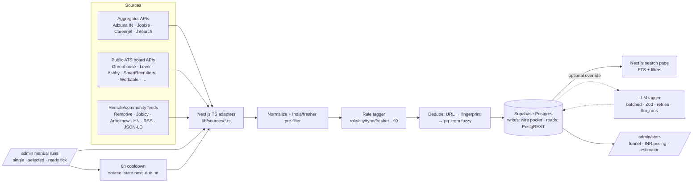

# 01 — Architecture

> **As-built.** Next.js (App Router, TS) on Vercel + **Supabase Postgres**. No
> cron, no Python worker, no Drizzle. Sources are all TS adapters. Jobs are
> **rule-tagged at ingest** (free); the LLM is an optional override. Runs are
> triggered **by hand from `/admin`**, and each source cools down for **6 h** after
> a run. Money is reported in **INR** (see `07`).

## Components
| Component | Tech | Why |
|---|---|---|
| Web + API | Next.js (App Router, TypeScript) on Vercel | One deploy for UI, ingest, tagging, admin, stats |
| DB | **Supabase Postgres** (free tier) | Real FTS (`tsvector`), `pg_trgm` fuzzy dedupe, hosted Auth + PostgREST |
| DB access | **postgres.js** wire (writes) + **PostgREST** fetch (reads) | Pooler-safe writes with 12 s auto-cancel; stateless reads that can't orphan a backend |
| Source adapters | TS modules implementing `SourceAdapter` | One file per source; registry merged with DB `source_admin` patches/custom |
| Rule tagger | `lib/rule_tagger.ts` (keywords + gazetteer) | Deterministic, ₹0, tags at INSERT so jobs are instantly filterable |
| LLM tagger (optional) | `@anthropic-ai/sdk`, `lib/tagger.ts` | Structured JSON, temperature 0, batched, cached prompt, repair retry |
| Scheduler | `lib/scheduler.ts` + `lib/runner.ts`, **manual** from `/admin` | No cron; run single/selected/ready; 6 h cooldown + quotas + backoff |
| Admin auth | Supabase Auth + `ADMIN_EMAILS` allowlist | Bearer access token → `requireAdmin()`; admin routes gated |
| Secrets | `integration_secrets` (AES-256-GCM) + `SOURCE_KEYS_SECRET` | Encrypted API keys at rest, global by name, shared across sources |
| Pricing | `lib/pricing.ts` + `/api/stats` + `/admin/stats` | Live INR cost/1,000 from logged tokens; configurable rates + FX |
| Tests | Vitest | normalize, dedupe, cities, prefilter, tagger, pricing, integrations, db-errors |
| Observability | `ingest_runs`, `llm_runs`, `source_state`, `source_quota_usage` + `/admin/stats` | Feeds the video and the cost number |

## Key design decisions (use in the video)
1. **Adapter pattern** — every source returns `RawJob`; one normalizer; one dedupe; one rule tagger; optional LLM override.
2. **Idempotent ingest** — `UNIQUE(canonical_url)` + `UNIQUE(fingerprint)`; re-running never double-inserts.
3. **Cheap before smart** — regex/gazetteer pre-filter drops non-India/senior roles, and **rule tagging at ingest means ₹0 marginal cost**. The LLM is opt-in, not on the critical path.
4. **Tagging is inline, not a queue** — rows enter `tag_status='done'` (`rule-v1`). A separate manual LLM pass can override; a backfill (`retag`) tags pre-existing rows with the same rules.
5. **Manual runs + 6 h cooldown** — no cron to babysit; `/admin` runs due sources, and `source_state.next_due_at` keeps a source from re-running for 6 h after any attempt.
6. **Pooler-safe DB** — wire writes auto-cancel at 12 s (no orphaned backends); reads go over stateless PostgREST. This fixed the bulk-run 503 / pool-saturation spiral.
7. **Stale handling** — rows not seen for 14 days flip `is_active=false` instead of being deleted.
8. **Honest cost in INR** — actual spend from `llm_runs` tokens, rule-vs-LLM split so the unit rate isn't diluted, configurable provider rates + FX, live estimator.

## Deliberate deltas from the original plan
| Plan said | As-built | Why |
|---|---|---|
| Neon + Drizzle | Supabase + postgres.js / PostgREST | Hosted Auth + REST + pooler in one; no ORM needed |
| Vercel Cron + GitHub Actions | Manual `/admin` runs + 6 h cooldown | Assignment runs on demand; no unattended cron required |
| LLM-first tagging queue | Rule-first at ingest, LLM optional | ₹0 default, instantly filterable, no timeout risk |
| Python worker for HTML sources | All-TS adapters (JSON-LD/RSS/ATS) | Every chosen source is plain-HTTPS fetchable |
| Cost in USD, hand-measured | Live INR engine + estimator | Real logged tokens, configurable FX, transparent |